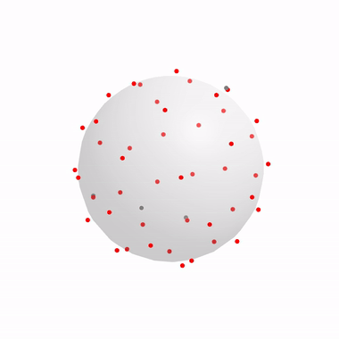
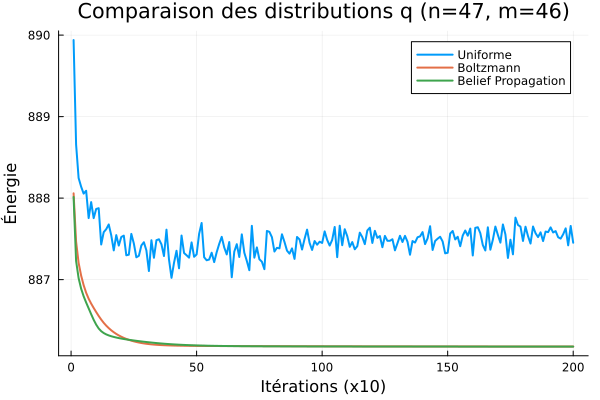
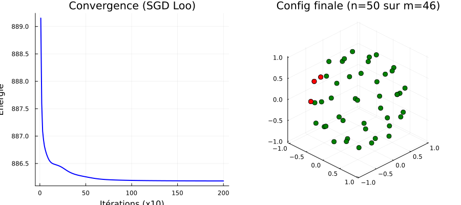
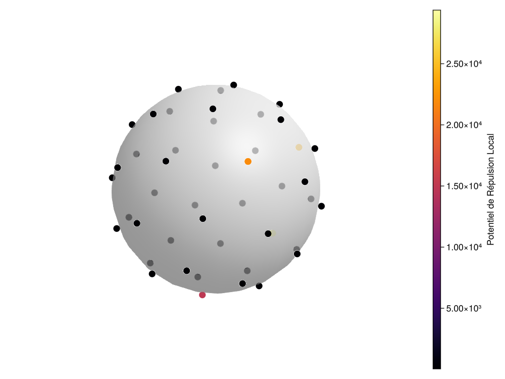

# Combinatorial Relaxation for Point Set Optimization — Thomson Problem

<p align="center">
  
  <br/>
  <em><b>Live SGD on the combinatorial relaxation</b>: particles evolving on $\mathcal{S}^2$ with Belief Propagation subset sampling (red: active subset, gray: reservoir).</em>
</p>

[](https://github.com/Erratu/Gipsa-lab/actions)
[](https://opensource.org/licenses/MIT)
[](https://julialang.org)

> A novel combinatorial relaxation framework for global optimization on manifolds, applied to the Thomson problem. Research internship at [CNRS Gipsa-Lab](https://www.gipsa-lab.grenoble-inp.fr/), Grenoble INP — Ensimag, supervised by [Simon Barthelmé](https://barthesi.gricad-pages.univ-grenoble-alpes.fr/).

---

## 🔬 Overview

The **Thomson problem** asks: what is the minimum-energy configuration of $m$ point charges confined to the surface of a unit sphere? It is a canonical NP-hard global optimization problem (one of [Smale's problems for the 21st century](https://en.wikipedia.org/wiki/Smale%27s_problems)) with an exponentially growing number of local minima.

**This project introduces a new optimization approach** based on **combinatorial relaxation**: instead of optimizing $m$ points directly, we embed them in an extended reservoir of $n > m$ points and optimize a relaxed cost function via **Stochastic Gradient Descent (SGD)**, where subsets are sampled at each step using learned heuristics.

### Key Mathematical Idea

$$G_n(Y) = \mathbb{E}_{X \sim q(\cdot | Y)}[H(X)] = \sum_{X \subset Y,\, |X|=m} q(X) \cdot H(X)$$

The relaxed objective $G_n$ interpolates between:
- $n = m$: the original (non-convex, rugged) problem
- $n \to \infty$: the convex relaxation over continuous measures (BLASSO)

### Subset selection heuristics

We implement and compare three sampling strategies for the selection distribution $q$:

| Strategy | Description | Complexity |
|----------|-------------|------------|
| **Uniform** | Baseline unbiased random selection | $O(1)$ |
| **Boltzmann** | Sequential greedy elimination weighted by local energy | $O(n \cdot (n-m))$ |
| **Belief Propagation** | Loopy Sum-Product on the complete interaction graph + sequential decimation | $O(n^2 \cdot T_{BP})$ |

<p align="center">
  
</p>

---

## 📊 Benchmark Results ($m = 46$)

<p align="center">
  
</p>

| Method | Energy | Δ to Global Min | Time (s) |
|--------|--------|-----------------|----------|
| Projected Gradient Descent (PGD) | 886.1783 | 0.0112 | 0.019 |
| PGD + Momentum | 886.1852 | 0.0181 | 0.020 |
| JuMP/Ipopt (Interior Point) | 886.1702 | 0.0031 | 0.967 |
| **Manifold L-BFGS** | 886.1702 | 0.0031 | 0.095 |
| Parallel Tempering (PT) | **886.1671** | 0.0000 | 11.03 |
| Non-Reversible PT (NRPT) | **886.1671** | 0.0000 | 12.37 |
| **Ours (SGD + Boltzmann)** | **886.1671** | 0.0000 | **~3.5** |

Our method **matches the exact global ground state** discovered by Parallel Tempering while converging significantly faster thanks to reservoir overparameterization.

### Energy landscape analysis ($n = 38$)

<p align="center">
  
  <br/>
  <em>The two dominant macro-basins at n=38 — the global minimum basin does not have the largest attraction volume, causing standard local descent to fail ~50% of the time.</em>
</p>

---

## ⚡ Technical Highlights

- **HPC & Zero-Allocation Kernels**: Crucial numerical loops (`delta_energy_fast`, `thomson_energy_and_grad!`) use in-place coordinate mutations and scalar arithmetic, eliminating 80% of heap memory allocations and cutting runtime by $4\times$.
- **Riemannian Optimization**: Manifold L-BFGS and Riemannian projected Adam on the product manifold $(\mathcal{S}^2)^n$ via [Manopt.jl](https://manoptjl.org/).
- **Probabilistic Inference**: Sum-Product Belief Propagation on complete graphs with damping ($\lambda=0.8$) and dynamic chemical potential ($\mu$) for exact-size marginal control.
- **Advanced MCMC**: Full Non-Reversible Parallel Tempering (NRPT) implementation with deterministic even-odd swap (DEO) and monotonic interpolation for communication barriers.

---

## 🏗️ Project Structure

```
├── PTShared/              # Generic Parallel Tempering & NRPT engine
│   ├── src/               # PTSampler, PTState, PTHistory, NRPT algorithms
│   └── test/              # Standard Julia unit tests (runtests.jl)
│
├── ThomsonMeths/          # All Thomson optimization & relaxation methods
│   ├── src/               # Kernels, local optimizers, samplers (BP, Boltzmann, DPP), SGD
│   └── test/              # Comprehensive test suites
│
├── IsingSimu/             # 2D Ising simulation study (Heat Bath, Wolff, Wang-Landau)
│
├── statistical_mechanics/ # Educational Python scripts
│
├── results/
│   ├── figures/           # Benchmark charts, heatmaps, and animated GIFs
│   └── videos/            # Raw MP4 simulation trajectories
│
├── notebooks/
│   └── demo_thomson.jl    # Interactive Pluto.jl notebook
│
└── docs/
    └── Rapport_IRL.pdf    # Complete research report (in French)
```

---

## 🚀 Getting Started

### Prerequisites

- [Julia ≥ 1.10](https://julialang.org/downloads/)

### Installation

```julia
using Pkg

# Add local packages
Pkg.develop(path="PTShared")
Pkg.develop(path="ThomsonMeths")

# Instantiate dependencies
Pkg.instantiate()
```

### Quick CLI Benchmark

Run the comprehensive benchmark comparing all 4 algorithms directly from your terminal:

```bash
# Run quick benchmark with 10 particles
julia --project=ThomsonMeths benchmark.jl 10

# Run benchmark on Smale's 7th problem test case (e.g. 46 particles)
julia --project=ThomsonMeths benchmark.jl 46
```

### Quick Demo in Julia REPL

```julia
using ThomsonMeths

# 1. Random configuration of 46 electrons on S²
m = 46
X0 = random_configuration(m)
println("Initial energy: ", thomson_energy(X0))

# 2. Local descent: Manifold L-BFGS
X_lbfgs, history = solve_manifold_lbfgs_fast(X0)
println("L-BFGS energy:  ", thomson_energy_fast(X_lbfgs))

# 3. Global search: Combinatorial Relaxation with SGD + Boltzmann
n_reservoir = 80
X_pool = random_configuration(n_reservoir)
X_opt, history, counts = sgd_loo(X_pool, m, n_reservoir;
    strategy=:boltzmann, max_iter=3000, lr=0.01)
println("SGD+Boltzmann:  ", thomson_energy(X_opt[:, 1:m]))
```

### Running Tests

```julia
using Pkg
Pkg.test("PTShared")
Pkg.test("ThomsonMeths")
```

---

## 📄 Research Report

This project was conducted as part of the *Introduction à la Recherche en Laboratoire (IRL)* research project at **GIPSA-Lab** (CNRS / Grenoble INP - Ensimag), under the supervision of **Simon Barthelmé**.

The full 24-page research report detailing the theoretical background, mathematical derivations, combinatorial relaxation, and extensive numerical experiments is available in the repository:
- **[Read Full Research Report (PDF)](docs/Rapport_IRL.pdf)**

---

## 📖 References

1. Smale, S. (1998). *Mathematical problems for the next century.* Mathematical Intelligencer.
2. Wales, D. J. & Ulker, S. (2006). *Structure and dynamics of spherical crystals.* Physical Review B.
3. Syed, S. et al. (2022). *Non-reversible parallel tempering.* JRSS-B. [arXiv:1905.02939](https://arxiv.org/abs/1905.02939)
4. Denoyelle, Q. et al. (2019). *The sliding Frank-Wolfe algorithm.* IEEE Trans. Info. Theory.

---

## 📝 License

This project is licensed under the MIT License — see the [LICENSE](LICENSE) file for details.

## 👤 Author

**Anna Malet** — [GitHub](https://github.com/Erratu) · [anna.malet@grenoble-inp.org](mailto:anna.malet@grenoble-inp.org)

Supervised by **Simon Barthelmé** — CNRS, Gipsa-Lab
