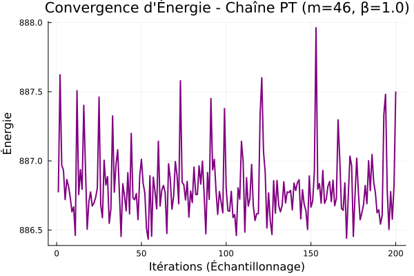

# Combinatorial Relaxation for Point Set Optimization — Thomson Problem

<p align="center">
  
</p>

> A novel combinatorial relaxation framework for global optimization on manifolds, applied to the Thomson problem. Research internship at [CNRS Gipsa-Lab](https://www.gipsa-lab.grenoble-inp.fr/), Grenoble INP — Ensimag, supervised by [Simon Barthelmé](https://barthesi.gricad-pages.univ-grenoble-alpes.fr/).

## 🔬 Overview

The **Thomson problem** asks: what is the minimum-energy configuration of $m$ point charges confined to the surface of a unit sphere? It is a canonical NP-hard global optimization problem (one of [Smale's problems for the 21st century](https://en.wikipedia.org/wiki/Smale%27s_problems)) with an exponentially growing number of local minima.

**This project introduces a new optimization approach** based on **combinatorial relaxation**: instead of optimizing $m$ points directly, we embed them in an extended reservoir of $n > m$ points and optimize a relaxed cost function via **Stochastic Gradient Descent (SGD)**, where subsets are sampled at each step using learned heuristics.

### Key idea

$$G_n(Y) = \mathbb{E}_{X \sim q(\cdot | Y)}[H(X)] = \sum_{X \subset Y,\, |X|=m} q(X) \cdot H(X)$$

The relaxed objective $G_n$ interpolates between:
- $n = m$: the original (non-convex) problem
- $n \to \infty$: the convex relaxation over measures (BLASSO)

### Subset selection heuristics

We implement and compare three sampling strategies for $q$:

| Strategy | Description | Complexity |
|----------|-------------|------------|
| **Uniform** | Baseline random selection | $O(1)$ |
| **Boltzmann** | Sequential greedy elimination weighted by local energy | $O(n \cdot (n-m))$ |
| **Belief Propagation** | Loopy Sum-Product on the complete interaction graph + sequential decimation | $O(n^2 \cdot T_{BP})$ |

<p align="center">
  
</p>

## 📊 Results

### Benchmark on Thomson problem ($m = 46$)

| Method | Energy | Δ to Global Min | Time (s) |
|--------|--------|-----------------|----------|
| Projected Gradient Descent (PGD) | 886.1783 | 0.0112 | 0.019 |
| PGD + Momentum | 886.1852 | 0.0181 | 0.020 |
| JuMP/Ipopt (Interior Point) | 886.1702 | 0.0031 | 0.967 |
| **Manifold L-BFGS** | 886.1702 | 0.0031 | 0.095 |
| Parallel Tempering | **886.1671** | 0.0000 | 11.03 |
| Non-Reversible PT (NRPT) | **886.1671** | 0.0000 | 12.37 |
| **Ours (SGD + Boltzmann)** | **886.1671** | 0.0000 | ~3.5 |

Our method **matches the global optimum** found by Parallel Tempering while being significantly faster than full MCMC replicas.

### Energy landscape analysis ($n = 38$)

<p align="center">
  
  <br/>
  <em>The two dominant macro-basins of the Thomson problem at n=38 — the global minimum is not the one with the largest basin of attraction.</em>
</p>

### SGD convergence dynamics

<p align="center">
  
</p>

## 🏗️ Project Structure

```
├── PTShared/              # Generic Parallel Tempering / NRPT engine
│   ├── src/
│   │   ├── PTShared.jl          # Module entry point
│   │   ├── pt_structures.jl     # PTSampler, PTState, PTHistory types
│   │   └── pt_gen_models.jl     # PT and NRPT generic algorithms
│   └── tests/
│       ├── test_gauss.jl        # Validation on Gaussian target
│       └── test_bimodal.jl      # Validation on bimodal target
│
├── ThomsonMeths/          # All Thomson optimization methods
│   ├── src/
│   │   ├── ThomsonMeths.jl      # Module entry point + exports
│   │   ├── thomson_functions.jl # Energy, gradient, Metropolis updates
│   │   ├── thomson_algos_optim.jl  # PGD, Momentum, L-BFGS, PT, NRPT, Basin-Hopping
│   │   ├── heuristics_n_m.jl    # Exhaustive, Greedy, BP, Gumbel-Softmax, Gurobi MIQP
│   │   ├── samplers_q.jl        # Boltzmann, BP, DPP subset samplers
│   │   ├── optimizers_n.jl      # SGD on combinatorial relaxation (core algorithm)
│   │   ├── tempering_setup.jl   # PT adapted to the combinatorial framework
│   │   └── min_e_thomson.jl     # Known optimal energies database
│   └── tests/
│
├── IsingSimu/             # Ising model simulations (warmup study)
│   ├── src/
│   │   ├── func_ising.jl        # Energy, adjacency matrices, Heat bath
│   │   └── ising_models.jl      # Wolff cluster, Wang-Landau
│   └── tests/
│
├── statistical_mechanics/ # Python exploratory scripts (Ising)
│
├── results/               # All benchmark figures and simulation videos
│   ├── figures/
│   └── videos/            # SGD evolution animations (.mp4)
│
├── notebooks/             # Interactive demo notebook
│   └── demo_thomson.jl
│
└── docs/
    └── Rapport_IRL.pdf    # Full research report (in French)
```

## 🚀 Getting Started

### Prerequisites

- [Julia ≥ 1.10](https://julialang.org/downloads/)
- Optional: [Gurobi](https://www.gurobi.com/) license (for exact MIQP comparisons)

### Installation

```julia
using Pkg

# Add the local packages
Pkg.develop(path="PTShared")
Pkg.develop(path="ThomsonMeths")
Pkg.develop(path="IsingSimu")

# Instantiate dependencies
Pkg.instantiate()
```

### Quick demo

```julia
using ThomsonMeths

# Generate a random configuration of 46 points on S²
m = 46
X0 = random_configuration(m)
println("Initial energy: ", thomson_energy(X0))

# Solve with Manifold L-BFGS (fast Riemannian local optimizer)
X_lbfgs, history = solve_manifold_lbfgs_fast(X0)
println("L-BFGS energy:  ", thomson_energy_fast(X_lbfgs))

# Solve with Parallel Tempering (global optimizer)
X_pt, _ = solve_pt_fast(m)
println("PT energy:      ", thomson_energy_fast(X_pt))

# Solve with our combinatorial relaxation method
n = 80  # reservoir size (n > m enables exploration)
X_reservoir = random_configuration(n)
X_opt, history, counts = sgd_loo(X_reservoir, m, n;
    strategy=:boltzmann, max_iter=3000, lr=0.01)
println("SGD+Boltzmann:  ", thomson_energy(X_opt[:, 1:m]))
```

### Known optimal energies

The project includes a database of known optimal Thomson energies for validation:

| $m$ | Optimal energy | Source |
|-----|---------------|--------|
| 10 | 32.71695 | [Cambridge DB](http://thomson.phy.cam.ac.uk/) |
| 20 | 150.88157 | |
| 32 | 412.26108 | |
| 38 | 543.03089 | |
| 40 | 599.83550 | |
| 46 | 886.16711 | |
| 100 | 4448.35058 | |

## 🛠️ Implemented Algorithms

### Local optimizers
- **Projected Gradient Descent (PGD)** — with and without momentum
- **Manifold L-BFGS** — Quasi-Newton on the product manifold $(S^2)^n$ via [Manopt.jl](https://manoptjl.org/)
- **Interior Point** — via [JuMP](https://jump.dev/) + [Ipopt](https://coin-or.github.io/Ipopt/)

### Global optimizers
- **Parallel Tempering (PT)** — multi-replica MCMC with temperature swaps
- **Non-Reversible PT (NRPT)** — following [Syed et al. (2022)](https://arxiv.org/abs/1905.02939)
- **Basin-Hopping** — random kicks + L-BFGS quench

### Combinatorial relaxation + SGD
- **Boltzmann sampler** — greedy sequential elimination
- **Belief Propagation sampler** — loopy Sum-Product on complete graph
- **DPP sampler** — Determinantal Point Process via Metropolis-Hastings
- **Gumbel-Softmax** — continuous relaxation via reparameterization trick

### Exact solvers (small instances)
- **Exhaustive search** — brute-force over all $\binom{n}{m}$ subsets
- **Gurobi MIQP** — Mixed-Integer Quadratic Programming

## 📖 References

1. Smale, S. (1998). *Mathematical problems for the next century.* Mathematical Intelligencer.
2. Wales, D. J. & Ulker, S. (2006). *Structure and dynamics of spherical crystals.* Physical Review B.
3. [Cambridge Thomson Problem Database](http://thomson.phy.cam.ac.uk/)
4. Syed, S. et al. (2022). *Non-reversible parallel tempering.* JRSS-B. [arXiv:1905.02939](https://arxiv.org/abs/1905.02939)
5. Wales, D. J. & Doye, J. P. K. (1997). *Global optimization by basin-hopping.* J. Phys. Chem. A.
6. Denoyelle, Q. et al. (2019). *The sliding Frank-Wolfe algorithm.* IEEE Trans. Info. Theory.

## 📝 License

This project is licensed under the MIT License — see the [LICENSE](LICENSE) file for details.

## 👤 Author

**Anna Malet** — [GitHub](https://github.com/Erratu) · [anna.malet@grenoble-inp.org](mailto:anna.malet@grenoble-inp.org)

Supervised by **Simon Barthelmé** — CNRS, Gipsa-Lab
